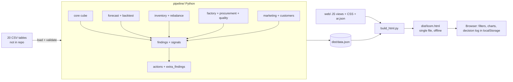

# El-Sharnouby Group Decision Intelligence — "Control Room"

A decision-support platform for **El-Sharnouby Group (Leo Moda)** that turns 20 operational tables into ranked findings, evidence-backed explanations, forecasts with measured error, and trackable actions across sales, margin, stock, factory, suppliers, marketing, quality and customers.

Every number is labelled **measured**, **forecast** or **assumption**, and the platform says *"not sure"* when the data cannot support a conclusion. It supports scenario testing, early-warning findings with root-cause hypotheses, a decision log, and a bilingual Arabic/English interface with RTL support and light/dark themes.

> Built for **HVIA Data & AI Solutions — Task 02** during an internship. Figures come from **modeled / anonymised training data**. This is a historical analysis: there are **no live integrations** (no ERP, machine or supplier feed).

## Quick start
```bash
python -m venv .venv && source .venv/bin/activate        # Windows: .venv\Scripts\activate
pip install -r requirements.txt
export RAW=/path/to/csv_folder                       # Windows PowerShell: $env:LOOM_RAW="C:\path\to\csv_folder"
python pipeline/build.py                                  # ~15 s -> dist/data.json
python build_html.py                                      # -> dist/loom.html (single file, opens offline)
```
The raw tables are **not in this repository** (privacy). Put the 20 CSV files in one folder and point `LOOM_RAW` at it. Open `dist/loom.html` in any browser; no server is needed. Set `LOOM_OUT` to write `data.json` elsewhere. Licensed *Thmanyah* fonts are not shipped; set `SHARNOUBY_FONTS` if you have them, otherwise system fonts are used.

## What is new in this version
| Area | What |
|---|---|
| **Control Room** | Management landing page, ordered by decision importance, with drill-down to channel, family and period. Replaces the earlier "Command Center". |
| **Demand vs Capacity** | New module (15). Forecast → bill-of-materials need → **order-by date per material**, with a selectable need-by month and lead-time basis (standard / average / 90th percentile). |
| **Three new findings** | F-11 cost of poor quality, F-12 at-risk wholesale and retail customers, F-13 December peak vs material lead times, each with evidence and an action (ACT-11 to ACT-13). |
| **Ask the data** | 11 prepared questions answered from the loaded numbers, each linking to the module that holds the evidence. A question finder, **not** a free-text chatbot. |
| **Print / Save PDF** | One-click print on every page, with print styling. |
| **Arabic** | Complete Arabic interface including the new pages, right-to-left layout. |
| **Reproducible build** | `LOOM_RAW` / `LOOM_OUT` environment variables; the pipeline rebuilds `data.json` from the CSVs. |

Kept from earlier versions: the analysis modules, Insights & Actions, Decision Log with owner/status/due date, System Map, Data Trust, light/dark theme, command palette (Ctrl/Cmd+K), model scorecards.

## Backtest (hold-out Jul–Sep 2026, `pipeline/forecast.py`, page *Data Trust*)
Forecast methods were fitted on months **before** the hold-out and scored on the last 3 months at product level (59 products) and at channel-total level. Metric: WAPE (lower is better); bias is signed.

| Method | Product-level WAPE | Channel-total WAPE | Bias |
|---|---|---|---|
| **Seasonal-naive × 12-month growth** (chosen) | **30.4%** | **4.5%** | +3.8% |
| 60/40 blend (seasonal + average) | 32.1% | 6.9% | +0.3% |
| 12-month moving average | 54.2% | 15.3% | −5.0% |

Reading: a seasonal pattern beats averaging by a wide margin in all three channels, so a heavier model was not adopted. Product-level error is much higher than channel-total error, so forecasts are trusted for planning volumes, **not** for individual SKU orders. A rolling-origin check over 10 monthly origins (Oct 2025 to Jul 2026) gives product-level WAPE between **23.9% and 36.4%**.

**Models that were rejected on evidence**
| Model | Result | Decision |
|---|---|---|
| Customer churn (6-month horizon, train to Sep 2025, test to Mar 2026, 20,854 test customers) | AUC **0.54** (0.5 = coin flip) | **Not deployed.** Lapse is described with RFM rules and observed re-purchase rates instead. |
| Volume response to discount depth (per channel) | 95% intervals include zero in Online, Retail and Wholesale | No volume gain from discount is claimed; the discount cap is modelled with a break-even, not a promised effect. |
| Platform-reported marketing ROAS | Platforms claim **2.9x** the revenue the business actually sold online and direct | Budgets are judged on blended MER; attribution is flagged as unreliable. |

## Key results on the modeled data
13 ranked findings (severity 1–4, with confidence), each linked to an action. Highlights:

| # | Finding | Evidence | Confidence |
|---|---|---|---|
| F-01 | Wholesale discounts are not tied to order size | Spearman ρ = 0.003 across 46,672 lines | High |
| F-03 | Stock is in the wrong place | Wholesale median cover **17 days**; store 236, online 187 | Medium |
| F-04 | Two suppliers deliver late far more than peers | On-time 40% and 35% vs about 70% | High |
| F-06 | Marketing revenue cannot be reconciled with sales | Reported revenue is 2.9x actual direct sales | High |
| F-11 | Poor quality costs about **EGP 6.5M** a year (4.4% of net sales) before production rejects | QC loss, print rework, quality refunds | Medium |
| F-13 | December forecast about **56% above October**; materials take up to **22 days** | The risk is timing, not machine hours | Medium |

Modelled profit actions are shown as **ranges, not promises** (for example capping wholesale discounts at 32%: EGP 1.7M to 3.3M a year, positive until 52% of affected volume is lost). Actions that cannot be priced from the data, such as supplier recovery or at-risk customer calls, are shown unpriced rather than invented.

> Gains are measured **inside the modeled dataset**. They show how the analysis works and how trade-offs behave, not a claim about verified savings.

## Architecture

There is **no server**. Analysis runs once in Python; the browser renders the embedded result and calculates filters and scenarios locally from a pre-aggregated cube. Decision Log status and owners are saved in the browser's `localStorage` only (not shared between users).

Modules: Control Room · Insights & Actions · System Map · Profitability · Discount Discipline · Channels & Expansion · Customer 360 · Marketing & Growth · Inventory & Replenishment · Stock Rebalancing · Factory & Production · Procurement & Suppliers · Quality & Returns · Demand vs Capacity · What-If Simulator · Early Warning · Decision Log · Ask the data · Data Trust.

## Data integrity (page *Data Trust*)
20 tables are profiled and **13 checks** are run: **2 pass, 10 warn, 1 fail**. They are shown to the user, not hidden:
- Pass: net sales = gross × (1 − discount) on every invoice line; sales units reconcile to inventory sold quantity.
- Warn: refunds are not deducted from net sales; inventory roll-forward breaks on 147 rows; factory output is 3.7x units sold; two materials are purchased but have no BOM line; no material stock balances.
- Fail: marketing attributed revenue is 2.9x actual direct sales.

Because of the warnings, production, purchasing and marketing figures are used for **ratios and rankings**, not for a profit reconciliation.

## Assumptions (read before presenting)
1. Data is modeled / anonymised training data; confirm EGP amounts against the ledger before acting.
2. No live feed: capacity is the **published** hub figure (5,000 pieces/day), not a measurement, and recorded output does not reconcile with sales, so capacity is relative.
3. Open purchase orders and material stock balances are not in the data; order-by dates ignore orders already in transit.
4. Lead times are historical (average and 90th percentile), not supplier commitments.
5. Store footfall and local competition are not in the data, so the cause of the store sales decline cannot be identified.
6. Impact ranges use stated assumptions (for example an assumed 10% to 30% reduction for ACT-11); they are bounds, not measured effects.

## Not included (on purpose)
Live ERP, machine or supplier integrations; a backend API or database (a single HTML file was chosen so it opens offline and can be audited); user accounts (the Decision Log is per browser); a mathematical optimizer (scenarios use transparent calculators and stock rebalancing uses a rule-based allocation, because no objective, constraints and cost data justified an optimizer); a customer churn model (rejected, see above); causal marketing attribution; an automated unit-test suite (integrity is checked by the 13 data checks and by rebuilding `data.json` from the CSVs).

## 4-minute demo
1. **Control Room** → headline, the chain strip (suppliers to profit), top findings.
2. **Insights & Actions** → open F-01, read the evidence and the *Arithmetic / Plausible / Unknown* labels, then the ranked actions.
3. **Discount Discipline** → move the cap and watch the break-even.
4. **Demand vs Capacity** → pick *Dec 2026* and *90th percentile*, read the order-by dates.
5. **What-If Simulator** → price, demand shock, supplier delay, marketing and capacity tabs against the baseline.
6. **Early Warning** → one finding with confidence and investigation steps.
7. **Decision Log** → set an owner and status for ACT-01.
8. **Ask the data** → "Why did gross margin stay flat while sales grew?" → open the evidence.
9. **Data Trust** → the failing check and the rejected churn model. Toggle **Arabic** and the dark theme, then **Print / Save PDF**.

Shortcut: **Ctrl/Cmd+K** jumps to any page.

## Project structure
```
.
├── pipeline/        # Python analysis: core, forecast, inventory, factory, procurement, marketing, customers, actions
├── web/             # JavaScript views, CSS, Arabic dictionary (ar.json)
├── assets/          # Embedded-font block reused by the build
├── dist/            # Generated: data.json, loom.html
├── build_html.py    # Bundles everything into one HTML file
├── requirements.txt
└── CHANGES.md
```

## Credits
Built during an internship at **HVIA Data & AI Solutions**, under the supervision of **Eng. Ayman**.
