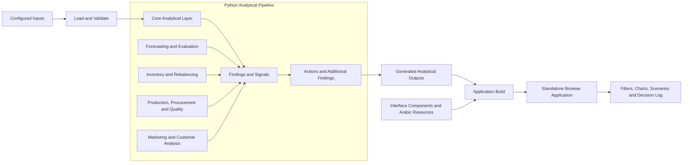

# El-Sharnouby Group Decision Intelligence — Control Room

A decision-support platform for **El-Sharnouby Group** designed to turn operational complexity into ranked findings, evidence-backed explanations, forecasts with measured error, and trackable actions across sales, profitability, inventory, production, suppliers, marketing, quality, and customers.

Every result is labelled **measured**, **forecast**, or **assumption**. When the available evidence cannot support a conclusion, the platform communicates uncertainty instead of presenting unsupported claims. It supports scenario testing, early-warning findings with root-cause hypotheses, a decision log, and a bilingual Arabic/English interface with RTL support and light/dark themes.

> Built for **HVIA Data & AI Solutions — Task 02** during an internship. The project is designed for historical analysis and decision support, with no live integrations to operational systems.

## Quick Start

```bash
python -m venv .venv
source .venv/bin/activate        

pip install -r requirements.txt

python pipeline/build.py
python build_html.py
```

The build process generates the files required to run the application locally. The interface opens in a browser without requiring a web server.

## What Is Included in This Version

| Area | Description |
|---|---|
| **Control Room** | Management landing page ordered by decision importance, with drill-down views by channel, product family, and period. Replaces the earlier Command Center. |
| **Demand vs Capacity** | Forecasting, bill-of-materials requirements, and order-by dates for each material, with a selectable planning month and lead-time basis: standard, average, or 90th percentile. |
| **Three New Findings** | F-11: cost of poor quality; F-12: at-risk wholesale and retail customers; F-13: December demand peak versus material lead times. Each finding is linked to an action, ACT-11 to ACT-13. |
| **Ask the Data** | Eleven prepared questions with answers linked to the relevant evidence and application module. It is a question finder, not a free-text chatbot. |
| **Print / Save PDF** | One-click printing with dedicated print styling on every page. |
| **Arabic Interface** | Arabic interface with right-to-left layout, including the latest modules. |
| **Reproducible Build** | A repeatable build process that regenerates the application's analytical outputs from its configured inputs. |

Features retained from earlier versions include Insights & Actions, a Decision Log with owner/status/due date, System Map, Data Trust, light/dark themes, a command palette (Ctrl/Cmd+K), and model scorecards.

## Forecast Backtest

**Evaluation period:** July–September 2026  
**Metric:** Weighted Absolute Percentage Error (WAPE; lower is better). Bias is signed.

Forecasting methods were fitted using periods preceding the hold-out window and evaluated at both product level and channel-total level.

| Method | Product-Level WAPE | Channel-Total WAPE | Bias |
|---|---:|---:|---:|
| **Seasonal-naive × 12-month growth** (selected) | **30.4%** | **4.5%** | +3.8% |
| 60/40 blend (seasonal + average) | 32.1% | 6.9% | +0.3% |
| 12-month moving average | 54.2% | 15.3% | −5.0% |

### Interpretation

The seasonal method outperformed the averaging methods in the evaluated channels, so a more complex model was not adopted.

Product-level error is substantially higher than channel-total error. Therefore, the forecasts are more suitable for planning aggregate volumes than for making individual product-level ordering decisions.

A rolling-origin evaluation across ten monthly origins, from October 2025 to July 2026, produced product-level WAPE values between **23.9% and 36.4%**.

### Models Rejected Based on Evaluation

| Model | Result | Decision |
|---|---|---|
| Customer churn, six-month horizon | AUC **0.54**, close to random classification at 0.50 | Not deployed. Customer lapse is described using RFM rules and observed repurchase rates instead. |
| Volume response to discount depth | 95% intervals include zero across Online, Retail, and Wholesale | No volume increase is claimed. Discount limits are evaluated using break-even analysis rather than a promised sales effect. |
| Marketing return-on-ad-spend attribution | Reported platform revenue differs substantially from reconciled direct sales | Budget evaluation uses blended MER, while attribution is treated as unreliable. |

## Key Findings

The application presents **13 ranked findings**, each with a severity level from 1 to 4, a confidence assessment, supporting evidence, and a linked action.

| ID | Finding | Supporting Evidence | Confidence |
|---|---|---|---|
| F-01 | Wholesale discounts are not associated with order size | Spearman ρ = 0.003 across 46,672 lines | High |
| F-03 | Inventory distribution may not match demand across locations | Wholesale median cover: **17 days**; store: **236 days**; online: **187 days** | Medium |
| F-04 | Two suppliers have substantially lower on-time delivery rates than peers | On-time rates of 40% and 35%, compared with approximately 70% | High |
| F-06 | Marketing-reported revenue does not reconcile with direct sales | Reported revenue is 2.9 times actual direct sales | High |
| F-11 | Estimated annual cost of poor quality is approximately **EGP 6.5M** before production rejects | Quality-control losses, print rework, and quality refunds | Medium |
| F-13 | December demand is forecast to be approximately **56% above October** | Material lead times can reach **22 days**; timing is the primary identified risk | Medium |

Estimated financial impacts are presented as **ranges, not promises**. For example, a wholesale discount cap of 32% produces a modeled annual impact range of EGP 1.7M–3.3M, remaining positive under the stated assumptions until 52% of affected volume is lost.

Actions that cannot be responsibly quantified are left unpriced rather than assigned unsupported financial values.

> Financial impact estimates are scenario-based outputs, not verified savings or guaranteed business outcomes. They depend on the assumptions and limitations documented within the application.

## Architecture

The application follows a local, Python-based analytical pipeline and a browser-based presentation layer.



### How It Works

1. **Input and validation:** The pipeline loads configured inputs and performs validation checks before analysis.
2. **Analytical processing:** Python modules handle the core analytical layer, forecasting, inventory, production, procurement, quality, marketing, and customer analysis.
3. **Findings and actions:** Analytical outputs are converted into ranked findings, signals, and trackable actions.
4. **Application build:** The generated outputs are combined with the interface components into a standalone browser application.
5. **Local interaction:** The browser renders the results and calculates filters and scenarios locally from pre-aggregated analytical outputs.

No backend server is required for the browser interface. Decision Log owners and statuses are stored in the browser's `localStorage` and are not shared automatically between users.

## Application Modules

- Control Room
- Insights & Actions
- System Map
- Profitability
- Discount Discipline
- Channels & Expansion
- Customer 360
- Marketing & Growth
- Inventory & Replenishment
- Stock Rebalancing
- Factory & Production
- Procurement & Suppliers
- Quality & Returns
- Demand vs Capacity
- What-If Simulator
- Early Warning
- Decision Log
- Ask the Data
- Data Trust

## Analytical Integrity

The application runs **13 integrity checks**, with the following results:

- **2 pass**
- **10 warn**
- **1 fail**

The checks are exposed to users instead of being hidden.

### Passing Checks

- Net sales reconcile with gross sales multiplied by one minus the discount on each invoice line.
- Sales units reconcile with the recorded inventory sold quantity.

### Warnings

- Refunds are not deducted from net sales.
- Inventory roll-forward does not reconcile across 147 rows.
- Recorded production output is 3.7 times the units sold.
- Two purchased materials have no corresponding bill-of-materials line.
- Material stock balances are unavailable.

### Failed Check

- Marketing-attributed revenue is 2.9 times actual direct sales.

Because of these limitations, production, purchasing, and marketing results are used for ratios, comparisons, and rankings rather than a complete profit reconciliation.

## Assumptions and Limitations

1. Financial estimates require verification against authoritative accounting records before operational use.
2. The stated production capacity of 5,000 pieces per day is a published reference figure, not a live measurement. Capacity comparisons should therefore be treated as relative.
3. Open purchase orders and material stock balances are not incorporated into the ordering-date calculations. The estimates do not account for orders already in transit.
4. Lead times are based on historical averages and the 90th percentile; they are not supplier commitments.
5. Store footfall and local competition are not incorporated, so the cause of the store sales decline cannot be identified conclusively.
6. Estimated impacts depend on explicit assumptions. For example, ACT-11 uses an assumed reduction of 10%–30%. These values represent scenario bounds, not measured effects.
7. Forecast accuracy varies by aggregation level. Product-level forecasts should not be interpreted as precise individual-item predictions.
8. Findings describe patterns and relationships in the available analysis. They do not automatically establish causation.

## Not Included by Design

The current architecture intentionally excludes:

- Live ERP, machine, or supplier integrations.
- A backend API or application database.
- Centralized user accounts and shared Decision Log state.
- A mathematical optimizer. Scenarios use transparent calculators, while stock rebalancing uses rule-based allocation because the required objective function, constraints, and cost inputs are not established.
- The customer churn model, which was rejected following evaluation.
- Causal marketing attribution.
- An automated unit-test suite. Analytical integrity is assessed through the 13 checks and by rebuilding the analytical outputs from the configured inputs.

## Four-Minute Demo

1. **Control Room:** Review the headline indicators, operational chain, and highest-priority findings.
2. **Insights & Actions:** Open F-01, review the evidence and the Arithmetic / Plausible / Unknown labels, then inspect the ranked actions.
3. **Discount Discipline:** Adjust the discount cap and observe the break-even calculation.
4. **Demand vs Capacity:** Select December 2026 and the 90th-percentile lead-time basis to review ordering dates.
5. **What-If Simulator:** Compare price, demand-shock, supplier-delay, marketing, and capacity scenarios against the baseline.
6. **Early Warning:** Review a finding, its confidence, and the recommended investigation steps.
7. **Decision Log:** Assign an owner and update the status of ACT-01.
8. **Ask the Data:** Explore the question, “Why did gross margin stay flat while sales grew?” and follow the linked evidence.
9. **Data Trust:** Review the failed integrity check and the rejected churn model. Switch to Arabic, enable dark mode, and test Print / Save PDF.

**Shortcut:** Ctrl/Cmd+K opens the command palette for navigating between modules.

## Project Structure

```text
.
├── pipeline/       # Python analytical modules
├── web/            # Interface components, styles and Arabic resources
├── assets/         # Embedded assets
├── dist/            # Generated application outputs
├── build_html.py   # Application build script
├── requirements.txt
└── CHANGES.md
```

## Credits

Built during an internship at **HVIA Data & AI Solutions**, under the supervision of **Eng. Ayman**.
