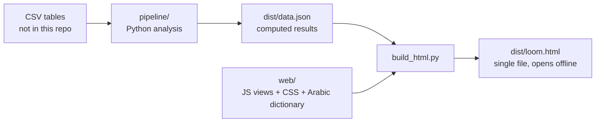

<div align="center">

# Sharnouby Intelligence

### From data to decisions, across the whole business.

A decision-intelligence platform for **El-Sharnouby Group (Leo Moda)**: fabric manufacturing, garment production, printing, retail, wholesale and online. Built for the **HVIA Data & AI Solutions · Task 02** challenge.


[What it does](#what-it-does) · [Modules](#modules) · [Architecture](#architecture) · [Run it](#run-it) · [Data and privacy](#data-and-privacy) · [Limits](#honest-limits)

</div>

---

## What it does

Most dashboards show *what happened*. This project tries to answer four questions for every number it shows:

| | Question | What the platform provides |
|---|---|---|
| **1** | What is happening? | Measured KPIs by channel, family, branch and period |
| **2** | Why? | Evidence, and a clear label: *arithmetic*, *correlated*, *plausible*, *unknown* or *ruled out* |
| **3** | What may happen? | Forecasts checked with a backtest, with their error shown |
| **4** | What should we do? | Ranked actions with owner, effort, confidence, risk and a KPI to track |

The 15 modules share one data model, so a finding in one place changes the advice in another. For example, a demand peak in the forecast flows into the material **order-by dates**, and into the **Early Warning** findings.

## Modules

| # | Module | Focus |
|---|---|---|
| 01 | **Control Room** | One screen for management, ordered by importance, with drill-down |
| 02 | **Inventory & Replenishment** | Cover, stock-out and excess risk, reorder needs |
| 03 | **Customer 360** | RFM segments, repeat purchase, at-risk accounts |
| 04 | **Factory & Production** | Bottlenecks, delays, overtime, downtime |
| 05 | **Marketing & Growth** | Platform performance and attribution limits |
| 06 | **Channels & Expansion** | Channel and location comparison |
| 07 | **Procurement & Suppliers** | On-time delivery, price, lead time, dependency |
| 08 | **What-If Simulator** | Compare scenarios against the baseline |
| 09 | **Early Warning** | Signals and findings with evidence and next steps |
| 10 | **Profitability** | Margin by product, channel and customer, waterfall view |
| 11 | **Stock Rebalancing** | Transfers between locations before producing or buying |
| 12 | **Quality & Returns** | Cost of poor quality, defects, returns |
| 13 | **Decision Log** | Status, owner and due date for every action |
| 14 | **Discount Discipline** | Discount depth against volume and margin |
| 15 | **Demand vs Capacity** | Forecast to bill-of-materials to order-by dates |
| · | **Insights & Actions** | Ranked findings and recommended actions |
| · | **System Map** | How the modules feed each other |
| · | **Ask the data** | Prepared questions answered from the loaded numbers |
| · | **Data Trust** | Data checks, definitions and model scorecards |

## Architecture

There is **no server**. Analysis runs once in Python and the result is embedded in a single HTML file that the browser renders.



| Layer | Path | Role |
|---|---|---|
| Analysis | `pipeline/*.py` | Reads the tables, builds KPIs, forecasts, findings and actions |
| Interface | `web/*.js`, `web/loom.css` | Views, charts, filters, light/dark theme |
| Language | `web/ar.json`, `web/i18n.js` | Full Arabic UI with right-to-left layout |
| Build | `build_html.py` | Bundles everything into `dist/loom.html` |

Filters (period, channel, family) are calculated in the browser from a pre-aggregated cube, so the page needs no network. Status and owner changes in the Decision Log are saved in the browser's `localStorage` only.

## Run it

**Requirements:** Python 3.12, `pandas`, `numpy`, `scipy`, `scikit-learn`.

```bash
pip install pandas numpy scipy scikit-learn
```

**1. Put your CSV tables in a folder** (the original dataset is not included, see below), then run the analysis:

```bash
# Linux / macOS
LOOM_RAW=/path/to/csv_folder python3 pipeline/build.py

# Windows PowerShell
$env:LOOM_RAW="C:\path\to\csv_folder"; python pipeline/build.py
```

This writes `dist/data.json`. Set `LOOM_OUT` to write somewhere else.

**2. Build the page:**

```bash
python3 build_html.py
```

Open `dist/loom.html` in a browser. Arabic / English and light / dark are switchable from the top bar.

> The interface uses licensed *Thmanyah* fonts that are not part of this repo. If you have them, set `SHARNOUBY_FONTS` to their folder. Otherwise the page falls back to system fonts.

## Data and privacy

- The dataset is **modeled / anonymised training data** supplied for the challenge.
- **The raw tables are not in this repository**, and `data_raw/` should stay out of version control.
- Every figure the platform shows is labelled as *measured*, *forecast* or *assumption*, and its source table is listed on the page.

Suggested `.gitignore`:

```
data_raw/
*.csv
__pycache__/
```

## Honest limits

This project is built to say what it does **not** know:

- **No live integrations.** Everything is historical data. There is no machine, ERP or supplier feed, so "Factory" is a planning view, not a digital twin.
- **Not all numbers reconcile.** Recorded production output is several times the units sold, so production and purchasing are used for ratios and rankings, not for a profit reconciliation.
- **Attribution is not proven.** Marketing platforms together claim far more revenue than the business sold, so budgets should not move on reported ROAS alone.
- **A weak model is not deployed.** The customer churn model barely beat chance, so the platform uses RFM rules and observed re-purchase rates instead.
- **Impact ranges are modelled bounds**, not verified savings. Capacity figures are the published ones, not measurements. Open purchase orders and material stock balances are not in the data.

## Project structure

```
.
├── pipeline/          # Python analysis (KPIs, forecast, findings, actions)
├── web/               # JavaScript views, CSS, Arabic dictionary
├── assets/            # Embedded-font block reused by the build
├── dist/              # Generated output (data.json, loom.html)
├── build_html.py      # Bundles everything into one file
└── CHANGES.md         # What changed in this version
```

## Credits

Built during an internship at **HVIA Data & AI Solutions** under the supervision of **Eng. Ayman**.

---

<details>
<summary><b>ملخص بالعربي</b></summary>

<div dir="rtl">

**Sharnouby Intelligence** منصة دعم قرار لشركة الشرنوبي (Leo Moda). بدل ما تعرض أرقام بس، كل رقم فيها بيجاوب على: إيه اللي بيحصل؟ ليه؟ إيه المتوقع؟ نعمل إيه وبأي مخاطرة؟

- **15 وحدة مترابطة**: الكنترول روم، المخزون، العملاء، المصنع، التسويق، الموردين، الربحية، الإنذار المبكر، محاكي السيناريوهات، الطلب مقابل الطاقة وغيرها.
- **واجهة عربي وإنجليزي** كاملة، ووضع فاتح وغامق.
- **مفيش سيرفر**: تحليل بايثون بيتشغل مرة واحدة، والنتيجة متضمّنة في ملف HTML واحد.
- **الداتا غير موجودة في الريبو** لأسباب الخصوصية، وهي بيانات تدريب modeled.
- **مفيش ربط لحظي**، والأرقام تاريخية، وكل رقم عليه مصدره وهل هو مقاس أو متوقع أو افتراض.

للتشغيل: ضع ملفات الـ CSV في فولدر، شغّل `pipeline/build.py` مع `LOOM_RAW`، ثم `build_html.py`.

</div>

</details>
